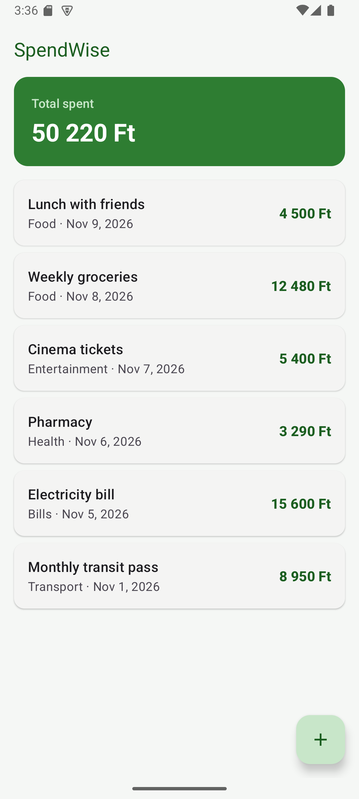
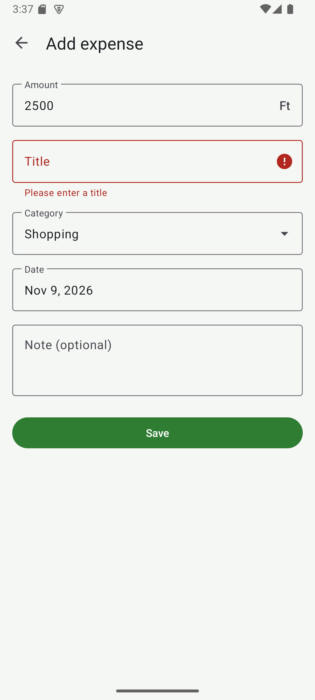
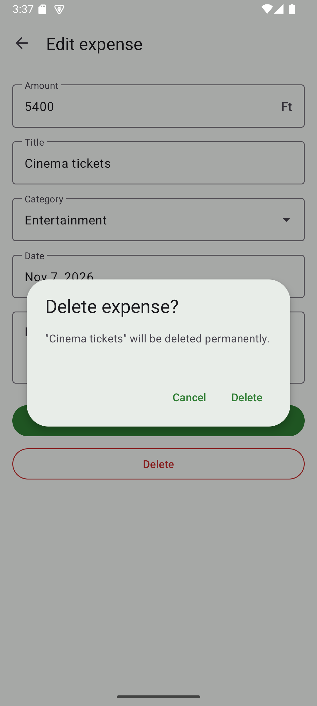

# SpendWise 💰

A simple Android expense tracker written in **Kotlin**. Add your expenses, see them in a list with the total spent in Hungarian Forint, and edit or delete them at any time. Everything is saved on the phone in a local **Room** database.

<p align="center">
  
  <!-- More screenshots (put the PNGs in docs/screenshots/ and uncomment):
  
  
  
  -->
</p>

## Features

- **Splash screen** with the SpendWise logo (official AndroidX SplashScreen API)
- **Expense list** with the **total** at the top, shown like `4 500 Ft`
- **Add / edit** an expense: amount, title, category, date and an optional note
- **Input validation**: amount must be a number greater than 0, title and category are required
- **Delete** with a confirmation dialog
- Data is stored **offline** in a Room (SQLite) database and the list updates automatically

## Tech stack

| What | Used |
|---|---|
| Language | Kotlin |
| UI | XML layouts, Material Design 3, RecyclerView |
| Database | Room (`Expense` entity, `ExpenseDao`, `AppDatabase`) |
| Background work | Kotlin coroutines (`suspend` + `lifecycleScope`) |
| Live updates | LiveData |
| Min / target SDK | 24 (Android 7.0) / 37 |

## How it works

```
MainActivity ──observes──▶ ExpenseDao.getAll(): LiveData<List<Expense>>
     │                              ▲
     │ tap row / + button           │ insert / update / delete (suspend)
     ▼                              │
AddEditExpenseActivity ─────────────┘
```

1. `MainActivity` observes `getAll()`. Every time the table changes, Room sends the new list. The screen then updates the `RecyclerView` (through `ExpenseAdapter`) and recalculates the total.
2. The **+** button opens `AddEditExpenseActivity` without an id, which means "add new". Tapping a row opens it with the expense's id, which means "edit".
3. When you tap **Save**, the input is validated. Then `insert` or `update` runs in the background and the screen closes. The list on the main screen updates by itself because of LiveData.
4. **Delete** (only in edit mode) asks for confirmation first, then calls `delete`.

## Project structure

```
app/src/main/
├── java/com/yamen/spendwise/
│   ├── MainActivity.kt            # list + total + add button (+ splash screen)
│   ├── AddEditExpenseActivity.kt  # add / edit / delete form with validation
│   ├── ExpenseAdapter.kt          # RecyclerView adapter for the list
│   ├── Format.kt                  # "4 500" and date formatting
│   └── data/
│       ├── Expense.kt             # @Entity: the expenses table
│       ├── ExpenseDao.kt          # @Dao: database queries
│       └── AppDatabase.kt         # @Database: singleton Room database
└── res/
    ├── layout/                    # activity_main, activity_add_edit_expense, item_expense
    ├── drawable/ic_logo.xml       # the logo (vector), also the app icon
    └── values/                    # strings.xml (all texts), colors.xml, themes.xml
```

All user-facing text is in `res/values/strings.xml`, so the app can be translated without changing any code.

## Run it

1. Clone the repository and open it in **Android Studio**.
2. Wait for Gradle sync, then press **Run ▶** on an emulator or a phone (Android 7.0+).

Unit tests (amount formatting):

```bash
./gradlew test
```
